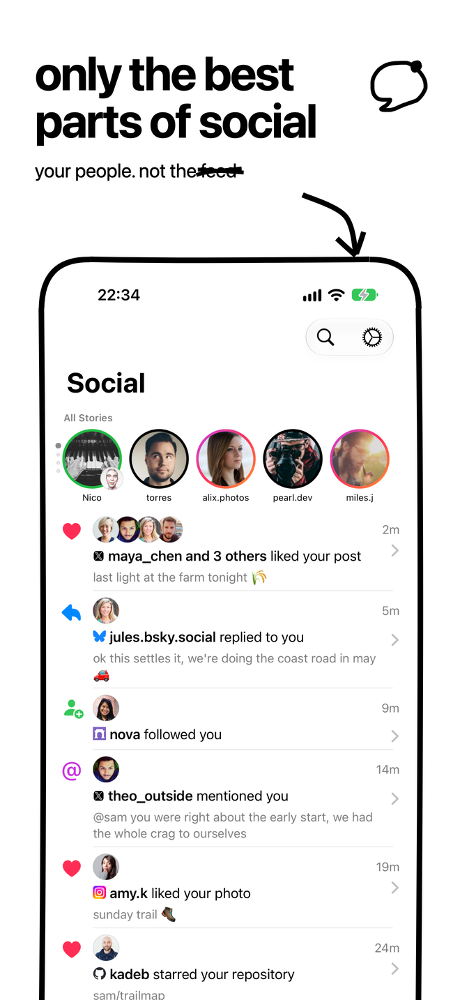
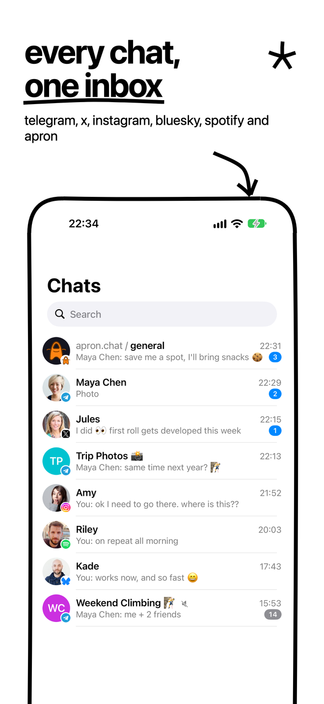
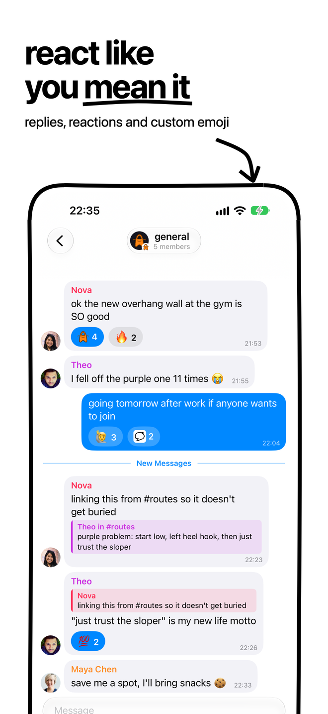
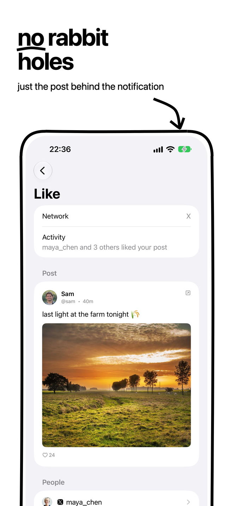
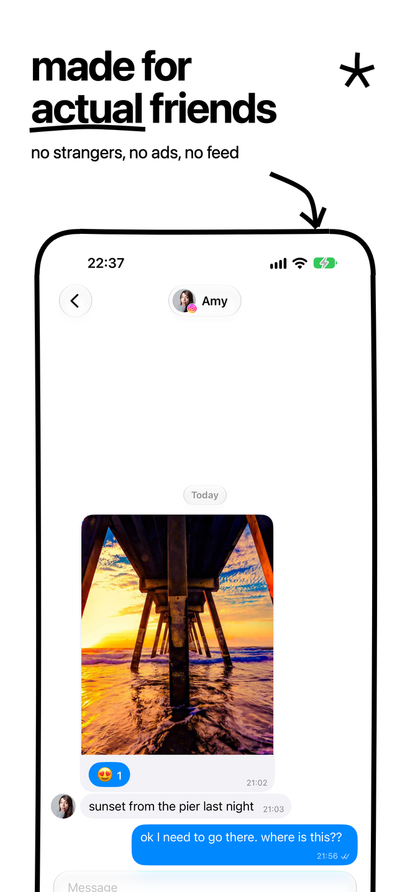

# stupid social

Only the best parts of social.

Your notifications, friends' stories and every chat from X, Instagram, Telegram, Bluesky and more, in one calm iOS app. No feed. No algorithm. No doomscroll.

## Screenshots

<p align="center">
  
  
  
  
</p>
<p align="center">
  
  
  
</p>

## Features

- One inbox for Telegram, X, Instagram, Bluesky, Spotify and Apron chats, with replies, reactions, custom emoji, edits, photos, videos, voice notes and files
- Notifications meant for you from X, Farcaster, Instagram, Bluesky and GitHub: mentions, replies, likes and follows
- A story bar with Instagram stories, what friends are listening to on Spotify, and GitHub activity
- The post behind a notification, so you can like, reply or repost without falling into the feed
- Reminders on messages you want to get back to
- Any number of accounts per network, synced across your devices with iCloud Keychain

What's not in it: no algorithmic feed, no ads, no tracking. The app counts anonymous usage and crashes, never your messages, names or accounts.

## Setup

Built and released with the `stupid-app` CLI (no Xcode project). Configuration is in `stupid-app.yml`.

```bash
git clone git@github.com:stephancill/stupid-social.git
cd stupid-social
```

Telegram needs an API id and hash from [my.telegram.org](https://my.telegram.org). Put `TELEGRAM_APP_ID` and `TELEGRAM_APP_API_HASH` in `.env.local`, then write the gitignored config the build reads:

```bash
python3 scripts/telegram-api-config.py
```

Without it the app builds, but Telegram shows as unavailable.

### Build and run

```bash
stupid-app build
stupid-app run --simulator   # or --usb / --network for a device
```

### Release

```bash
stupid-app release external-beta --group-name External
```

See `AGENTS.md` for the release conventions (build numbers, `testflight/<build>` tags, What to Test notes).

## Docs

- `docs/PLAN.md`: requirements
- `docs/TECHNICAL_DESIGN.md`: architecture
- `docs/IMPLEMENTATION.md`: implementation notes and endpoint behavior
- `docs/app-store-copy.md`: App Store listing copy
